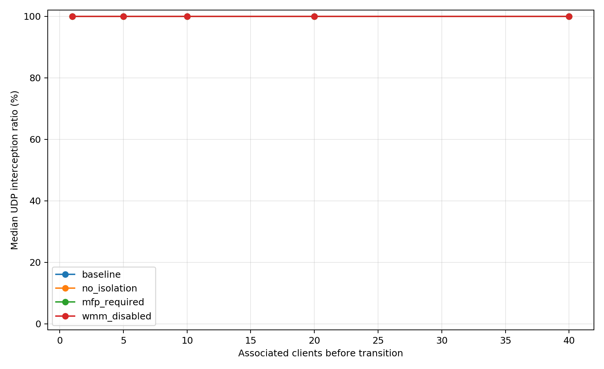
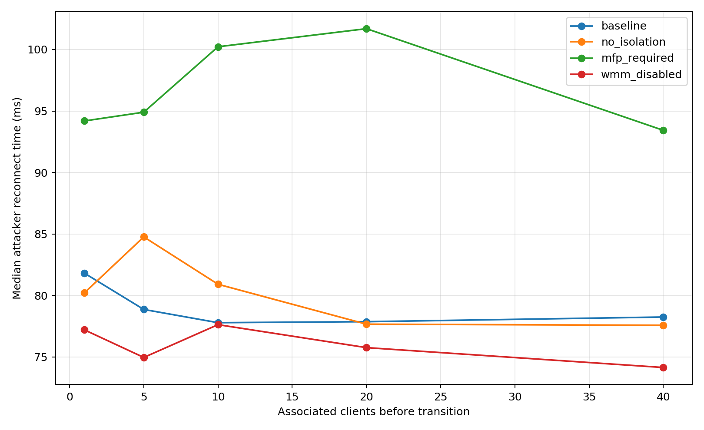
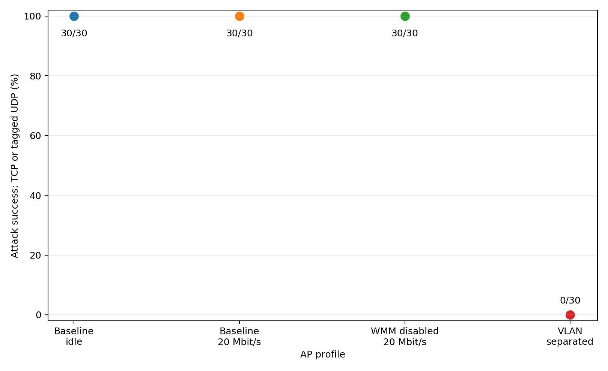
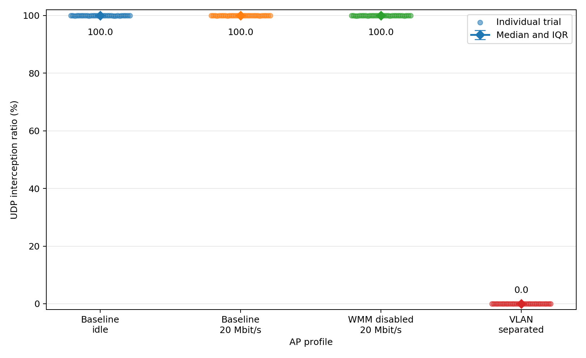
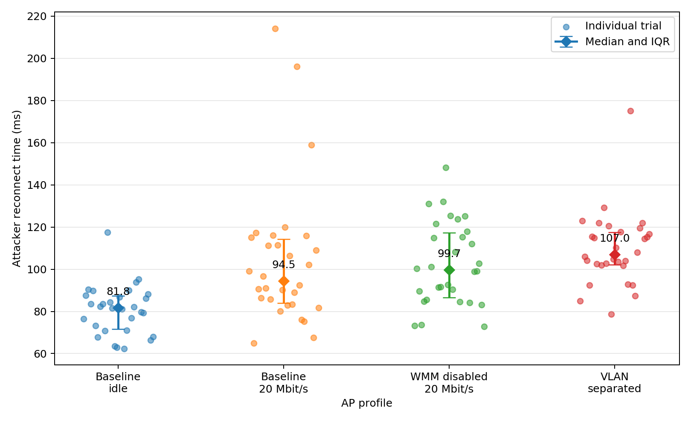
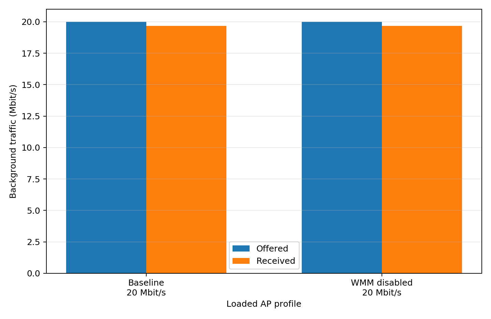
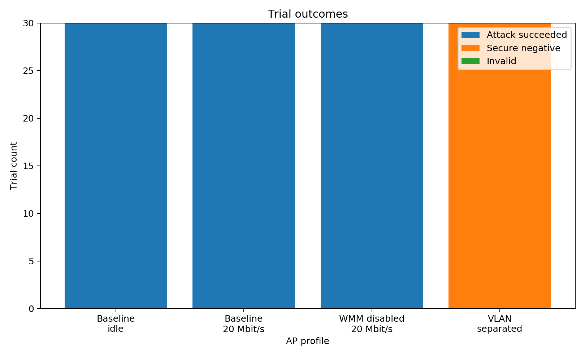

# MacStealer Mininet-WiFi Lab: Overview

Setup and operating instructions are in [instructions.md](instructions.md).
The processed datasets are under
[results/analysis](results/analysis/README.md) for the original 600-trial
matrix and [results/followup](results/followup/README.md) for the focused
120-trial follow-up.

## Executive summary

I built a controlled Mininet-WiFi lab to demonstrate and measure the MacStealer
client-isolation bypass (CVE-2022-47522). The attack was tested only against
simulated stations and a local server inside an isolated virtual machine.

The work had two parts:

1. Demonstrate the normal upstream MacStealer attack and preserve terminal,
   configuration, and packet-capture evidence.
2. Run a repeatable experiment measuring attack success, intercepted traffic,
   and reconnection timing while changing the number of associated clients and
   selected AP settings.

The final experiment contained 600 valid trials. The attack succeeded in all
600 trials, including all 600 strict TCP checks. It intercepted 599,921 of
599,987 tagged UDP packets, an aggregate interception ratio of 99.989%.

A subsequent 120-trial study tested idle operation, measured 20 Mbit/s uplink
load with WMM enabled or disabled, and forwarding separation. The attack
succeeded in all 90 same-domain trials and failed in all 30 separated-domain
trials. This provided a repeatable negative control and demonstrated that
credential-bound forwarding separation mitigated the tested attack path.

## What MacStealer demonstrates

Wi-Fi authentication establishes encryption keys, but downstream traffic is
normally routed to a station using its MAC address. MacStealer disconnects a
victim and reconnects with the victim's MAC address while using the attacker's
own valid credentials. On a vulnerable network, the AP associates the victim's
MAC address with the attacker's new encryption keys. Traffic intended for the
victim can then be encrypted for and delivered to the attacker.

This is relevant when client isolation is enabled. Client isolation may block
ordinary station-to-station attacks, but it does not necessarily prevent this
security-context replacement.

MacStealer does not break WPA encryption or recover the victim's password. It
assumes a malicious insider who already has valid network credentials. TLS and
other end-to-end encryption still protect application payload contents.

Upstream project: <https://github.com/vanhoefm/macstealer>

## Lab environment

- Ubuntu/Mininet-WiFi virtual machine
- Linux kernel 5.15.0-139-generic
- Mininet-WiFi with `mac80211_hwsim`
- hostapd 2.12 development version
- MacStealer commit `83851791bc2657bd9f2f384d6b739956ab2c3ea8`
- MacStealer installed under `/opt/macstealer`
- Lab harness under `~/macstealer-lab`
- Local-only server; no external systems were targeted

### Simplified topology

```text
                           +----------------------+
                           | local test server    |
                           | TCP 4444 / UDP 5555  |
                           | 10.77.0.1            |
                           +----------+-----------+
                                      |
                            +---------+---------+
                            | Mininet-WiFi AP   |
                            | WPA2 multi-PSK    |
                            +---------+---------+
                                      |
              +-----------------------+----------------------+
              |                       |                      |
       victim/attacker            background             background
       lab-wlan0                   station(s)             station(s)
       10.77.0.20
```

The victim and attacker used different PSKs on the same SSID. During the
attack, the attacker reconnected using the victim's MAC address but retained
the attacker's valid credential identity.

## Measurement design

### Independent variables

Five associated-client counts were tested:

- 1 client
- 5 clients
- 10 clients
- 20 clients
- 40 clients

The count includes the victim. The remaining clients were idle background
stations, allowing the experiment to test association scale without also
changing offered traffic load.

Four AP profiles were tested:

| Profile | Configuration | Role in experiment |
|---|---|---|
| `baseline` | Client isolation on, MFP off, WMM on | Main vulnerable case |
| `no_isolation` | Client isolation off | Positive control |
| `mfp_required` | Client isolation on, MFP required | Tests whether MFP changes the outcome |
| `wmm_disabled` | Client isolation on, WMM off | Tests queuing/QoS timing effects |

These profiles are configuration comparisons, not four proposed defenses.
In particular, MFP can make forced disconnection harder in a real network, but
it is not a complete mitigation for this attack flow.

### Trial matrix

```text
5 client counts x 4 AP profiles x 30 trials = 600 trials
```

Client counts were randomized inside each AP-profile block. Each trial started
a fresh topology and produced its own logs, JSON result, and packet captures.

### Traffic measurement

The original TCP SYN/SYN-ACK proof was retained as a strict binary test. A
separate tagged UDP stream was added to measure volume:

- 100 UDP packets per second
- 1,200-byte tagged payload
- 10-second post-association observation window
- Unique sequence numbers used to prevent double-counting
- Nominal payload per trial: 1,200,000 bytes

The local server recorded which packets it sent, and the attacker recorded the
unique packets it received after association. This allowed the interception
ratio to be calculated as:

```text
unique tagged packets received / unique tagged packets sent in the window
```

### Trial validity

A trial was valid only when:

- victim authentication succeeded;
- attacker authentication succeeded;
- DHCP and local server preflight checks succeeded;
- the measurement process completed successfully; and
- tagged server traffic existed during the observation window.

Authentication, DHCP, server, emulator, and tool failures were treated as lab
failures and were rerun. A valid trial with no intercepted TCP or UDP traffic
would have been classified as `secure_negative`.

## Automation and artifacts

The harness automated the following work for every trial:

1. Generate the AP and client configuration.
2. Create the selected number of hwsim stations.
3. Start hostapd, background supplicants, DHCP, the local server, and captures.
4. Verify all preconditions.
5. Start the tagged traffic generator.
6. Run the instrumented same-BSS MacStealer transition.
7. Observe traffic for ten seconds after attacker association.
8. Write structured results and clean up the topology.

Important output files included:

- `result.json` per trial
- `server-events.jsonl`
- `measurement-events.jsonl`
- `hostapd.log`
- `macstealer.log`
- `server.pcap` and `attacker.pcap`
- generated hostapd and supplicant settings
- `trials.csv`, `summary.csv`, and `analysis.json`
- success-rate, interception-ratio, and reconnection-latency figures

## Results

### Completeness and success

- 600 unique results found
- 600 valid trials
- 20 profile/client-count cells
- 30 valid trials per cell
- no remaining infrastructure failure classes
- 600/600 combined TCP-or-UDP successes
- 600/600 strict TCP successes

Each cell observed 30 successes in 30 valid trials. The per-cell Wilson 95%
confidence interval is approximately 88.65% to 100%. The observed point
estimate is 100%; the interval reflects the finite sample size.

### Intercepted traffic

- Tagged packets sent: 599,987
- Unique tagged packets intercepted: 599,921
- Packets not observed by the attacker: 66
- Aggregate interception ratio: 99.989%
- Tagged UDP payload intercepted: 719,905,200 bytes
- Median tagged payload per trial: 1,200,000 bytes

Individual windows contained 999 to 1,001 packets because of timer scheduling
at observation-window boundaries. All packet, byte, and ratio calculations
were internally consistent.

### Reconnection timing

| Profile | Aggregate median attacker reconnect time |
|---|---:|
| Baseline | 78.75 ms |
| No isolation | 79.14 ms |
| MFP required | 95.58 ms |
| WMM disabled | 76.51 ms |

MFP required approximately 16.8 ms more median reconnect time than baseline,
but did not reduce attack success or intercepted volume. This should be
reported as a descriptive result rather than proof of causation, because AP
profiles were run in blocks.

### Effect of client count

There was no monotonic relationship between associated-client count and attack
success, intercepted volume, or attacker reconnect time. The background
stations were idle, so this result means that association count alone did not
materially change the outcome in this hwsim experiment. It does not describe a
congested radio network.

### Figure interpretation

The regenerated graphs offset equal profile series slightly around each client
count so all four remain visible. Suitable captions are:

> All four original AP profiles observed 30 successes in 30 valid trials at
> every tested client count. Series are offset slightly for visibility.

> Median UDP interception was 100% in every cell. Across all raw trials,
> 599,921 of 599,987 tagged packets were intercepted (99.989%).






## Main conclusions

1. The controlled Mininet-WiFi AP was consistently vulnerable to MacStealer.
2. Client isolation did not prevent the security-context override.
3. Increasing idle associated clients from 1 to 40 did not reduce reliability.
4. MFP increased reconnection latency but did not stop the scripted attack.
5. Disabling WMM did not produce a material difference at this traffic level.
6. Once the attacker reconnected, almost all downstream tagged traffic for the
   victim was delivered to the attacker.

## Focused follow-up results

The completed follow-up fixed the associated-client count at five and ran 30
trials for each of four profiles, producing 120/120 valid trials with no
infrastructure failures. The two loaded profiles divided a measured 20 Mbit/s
uplink stream across four background stations, with the wired server as the
receiver.

| Profile | Valid | Attack success | Median UDP interception | Median reconnect | Median offered/received load |
|---|---:|---:|---:|---:|---:|
| `baseline_idle` | 30/30 | 30/30 | 100% | 81.82 ms | — |
| `baseline_load20` | 30/30 | 30/30 | 100% | 94.46 ms | 20.002 / 19.672 Mbit/s |
| `wmm_disabled_load20` | 30/30 | 30/30 | 100% | 99.71 ms | 20.001 / 19.674 Mbit/s |
| `vlan_separated` | 30/30 | 0/30 | 0% | 106.98 ms | — |

Across the three vulnerable same-domain profiles, the attack succeeded in all
90 trials and intercepted 89,974 of 89,988 tagged packets (99.984%). The
20 Mbit/s load increased median reconnect time relative to the idle profile,
but did not reduce observed success or median intercepted volume. Disabling
WMM under the same load produced a 5.25 ms higher median than loaded baseline;
the overlapping trial distributions mean this should remain a descriptive
observation rather than a causal claim.

The separated profile produced 30 valid secure negatives: normal victim and
attacker authentication completed, but none of the 29,994 tagged victim
packets reached the attacker.











### Forwarding-separation negative control

The strongest negative control models per-credential VLAN separation:

```text
VictimPass123   -> VLAN 10 -> victim subnet
AttackerPass123 -> VLAN 20 -> attacker subnet

Firewall: VLAN 20 cannot reach VLAN 10
```

For portability across Mininet-WiFi and hostapd builds, the automated profile
uses two BSSes with the same SSID and separate layer-2/IP domains. The victim is
pinned to the `10.77.10.0/24` BSS and the attacker to `10.77.20.0/24`. This
tests the relevant forwarding separation, but it is not a same-BSS hostapd
dynamic-VLAN implementation. Both credentials must work normally and obtain
independent DHCP leases while victim traffic remains confined to the victim
domain.

The observed result in all 30 separated trials was:

```text
valid_trial: true
victim_auth_ok: true
attacker_auth_ok: true
dhcp_ok: true
attack_success: false
tcp_success: false
udp_packets_intercepted_unique: 0
failure_class: secure_negative
```

This is a mitigation for the tested MacStealer path, not a universal solution
to all wireless client-isolation attacks. It should use proper firewall rules
and separate group-key handling.

Another upstream mitigation concept is to remember the credential/security
association recently used by each MAC address. An AP or controller can delay or
reject a rapid reconnection when the same MAC is presented with a different
credential. That requires AP/controller logic rather than a simple MFP switch.

The follow-up commands and validity criteria are in
[instructions.md](instructions.md#run-the-focused-follow-up).

## Limitations

- `mac80211_hwsim` is deterministic and does not reproduce real interference,
  fading, hidden nodes, or hardware/firmware behavior.
- Background clients were idle in the original matrix. The follow-up added
  controlled uplink load, but did not evaluate loaded downlink traffic.
- All vulnerable profiles achieved a ceiling success result. This limits
  comparisons among those profiles even though the separated negative control
  produced a distinct outcome.
- The portable separated profile used two pinned BSSes and IP domains rather
  than a same-BSS hostapd dynamic-VLAN deployment.
- AP profiles were blocked rather than fully interleaved, so timing differences
  may include block/order effects.
- No inferential hypothesis test was preregistered for reconnect-time
  differences; reported medians and quartiles are descriptive.
- The byte metric counts tagged UDP payload, not Wi-Fi framing overhead.
- Results apply to the tested hostapd, kernel, Mininet-WiFi, and MacStealer
  versions.
- Higher-layer encryption such as TLS was outside the test; it would protect
  content even if link-layer frames were redirected.
